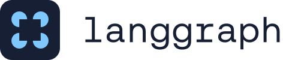
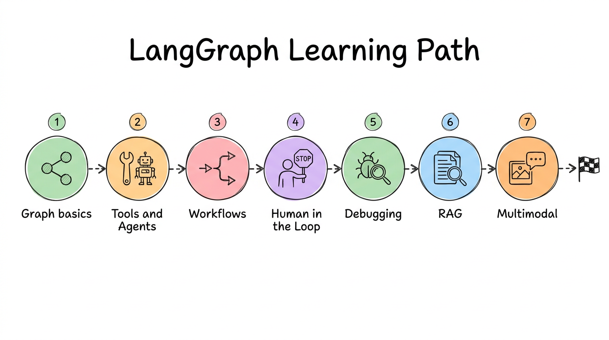
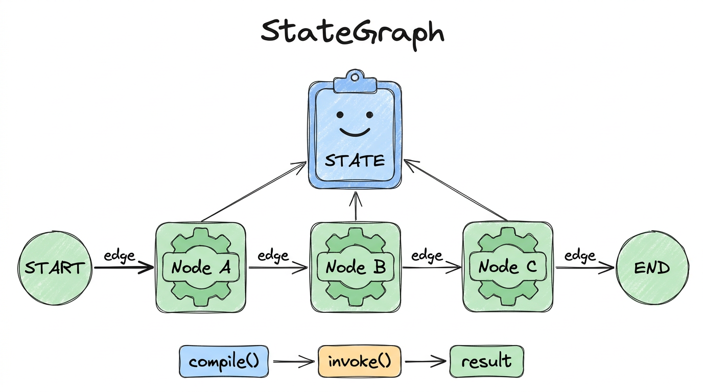
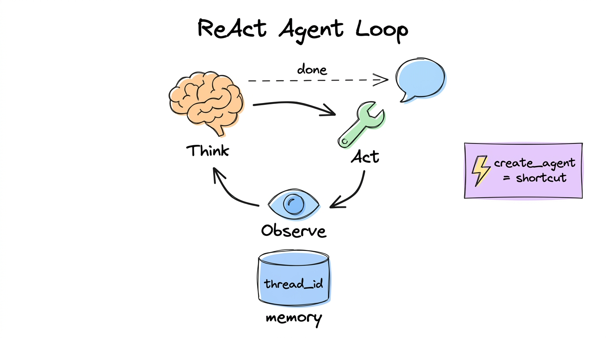
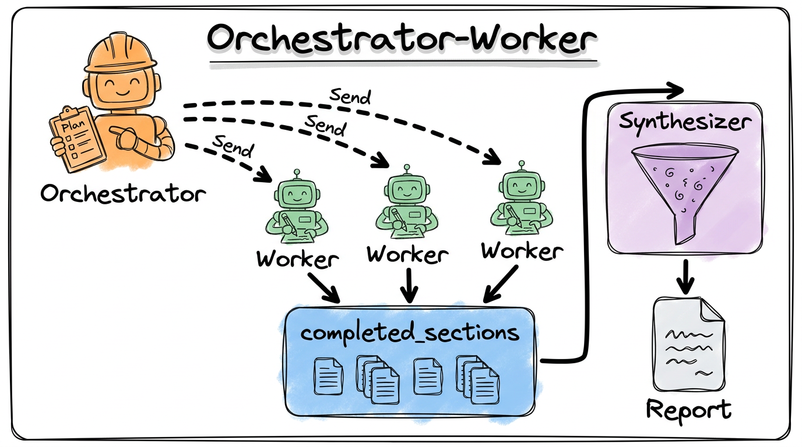
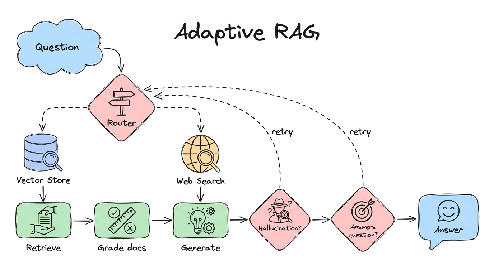
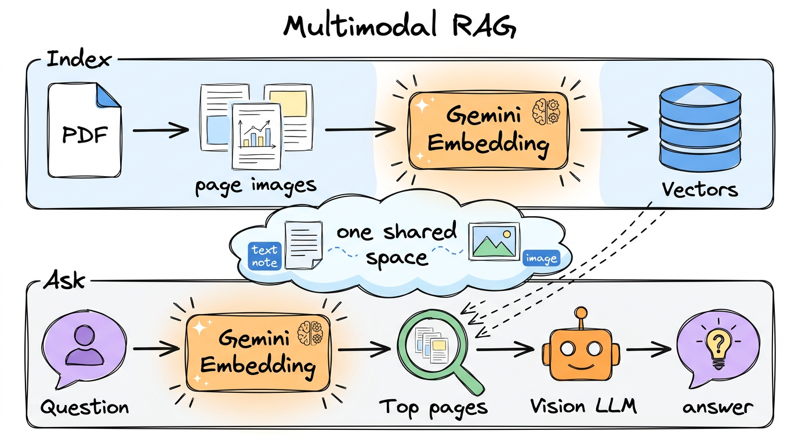

<div align="center">



# Learn LangGraph, one diagram at a time

Hands-on notebooks and an interactive slide deck that take you from your first graph to multimodal RAG.

[](https://d-hackmt.github.io/langgraph-life/)


<a href="https://d-hackmt.github.io/langgraph-life/"></a>

</div>

## What is inside

- **18 runnable notebooks** with saved outputs, written against current LangGraph and LangChain APIs (no deprecated imports).
- **22 hand-drawn diagrams**, one at the top of every notebook, so the idea is clear before the code.
- **An interactive deck** with a laser pointer, code panels, live demo, quizzes, speaker notes and dark mode.

## The deck

**[d-hackmt.github.io/langgraph-life](https://d-hackmt.github.io/langgraph-life/)**

| Key | Action | Key | Action |
|---|---|---|---|
| `←` `→` / `Space` | Navigate and reveal points | `L` | Laser pointer (fading trail) |
| `C` | Show the slide's code | `N` | Speaker notes |
| `O` | Overview of all slides | `D` | Dark / light |
| `F` | Fullscreen | `Esc` | Close panels, turn off laser |

You can also run it locally: open `deck/index.html` in a browser.

## Learning path

| # | Folder | You will learn | Diagram |
|---|---|---|---|
| 01 | [langgraph-basics](01-langgraph-basics) | `StateGraph`, nodes, edges, conditional edges, reducers, a first chatbot |  |
| 02 | [langgraph-components](02-langgraph-components) | Streaming, state schemas, tools, many tools, ReAct agents and memory |  |
| 03 | [debugging](03-debugging) | `langgraph.json`, `langgraph dev` and Studio |  |
| 04 | [workflows](04-workflows) | Prompt chaining, parallelization, routing, orchestrator-worker, evaluator-optimizer |  |
| 05 | [human-in-the-loop](05-human-in-the-loop) | Breakpoints, `interrupt()`, `Command(resume=...)` |  |
| 06 | [rag](06-rag) | Agentic, corrective and adaptive RAG |  |
| 07 | [multimodal](07-multimodal) | Page-image RAG with Gemini embeddings |  |

## Quick start

```bash
git clone https://github.com/d-hackmt/langgraph-life.git
cd langgraph-life

uv venv
uv pip install -r requirements.txt

cp .env.example .env      # add OPENAI_API_KEY and GEMINI_API_KEY
```

Open any notebook in VS Code or Jupyter and run it top to bottom.

- Chat and agents use **OpenAI** (`gpt-4.1-mini`).
- The multimodal notebook uses **Gemini** (`gemini-embedding-2`) for page-image embeddings.
- A free-tier Gemini key has a small daily limit for text generation, so the notebooks answer with OpenAI by default.

## Repository layout

```
01-langgraph-basics/        02-langgraph-components/    03-debugging/
04-workflows/               05-human-in-the-loop/       06-rag/
07-multimodal/              deck/  (HTML slides)        diagrams/  (22 PNGs)
requirements.txt            .env.example
```

## Notes

- Never commit your `.env`. It is already in `.gitignore`.
- Web search in the notebooks uses OpenAI's built-in search tool, so no extra key is needed. Swapping in Tavily is a one-line change (see the notebooks).
- The LangGraph logo is a trademark of LangChain and is used here for teaching.
