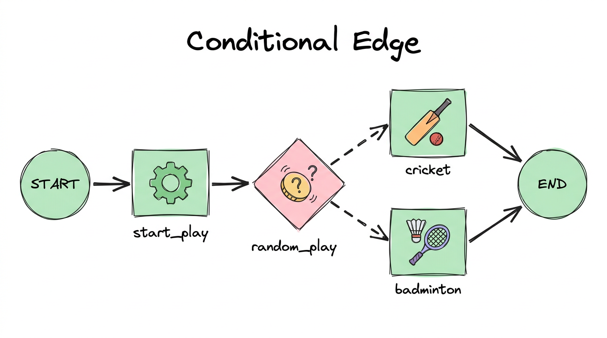
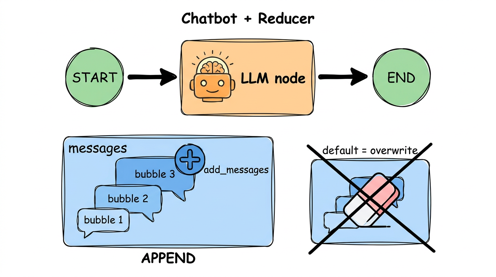

# 01. LangGraph basics


## What is inside

| Notebook | What it shows |
|---|---|
| [1-simplegraph](../01-langgraph-basics/1-simplegraph.ipynb) | Your first graph: state, nodes, edges, and a choice between two paths |
| [2-chatbot](../01-langgraph-basics/2-chatbot.ipynb) | A simple chatbot that remembers the conversation |

## The big idea, in simple words

A LangGraph program is a **flowchart that runs**. You draw boxes and arrows, and LangGraph follows them.

- **State** is a shared notebook. Every box can read it and write to it.
- **Node** is one box. It is just a Python function.
- **Edge** is an arrow. It says which box runs next.
- **START** and **END** are where the flowchart begins and finishes.

Think of a **pizza kitchen**. The order slip is the *state*. Each cook is a *node*: one adds sauce, one adds cheese, one bakes. The *edges* say who gets the pizza next.

## Example 1: a tiny graph

```python
class State(TypedDict):
    graph_info: str                      # the notebook everyone shares

def start_play(state: State):
    return {"graph_info": state["graph_info"] + " I am planning to play"}

builder = StateGraph(State)
builder.add_node("start_play", start_play)
builder.add_edge(START, "start_play")    # arrow: START -> start_play
builder.add_edge("start_play", END)      # arrow: start_play -> END
graph = builder.compile()

graph.invoke({"graph_info": "Hey"})
# {'graph_info': 'Hey I am planning to play'}
```

A node does not return the whole state. It returns **only what it changed**.

## Example 2: a choice (conditional edge)

Sometimes the next box depends on something. In the notebook, a coin flip picks **cricket** or **badminton**.



```python
def random_play(state) -> Literal["cricket", "badminton"]:
    return "cricket" if random.random() > 0.5 else "badminton"

builder.add_conditional_edges("start_play", random_play)
```

The function is not a box. It only **chooses the next box**. Real uses: "did the answer pass the check?", "does the user want a joke or a poem?".

## Example 3: a chatbot and the "reducer"



By default, when a node returns a value, it **replaces** the old one. For a chat, that would erase the history. A **reducer** changes the rule. `add_messages` means "add this to the list instead".

```python
class State(TypedDict):
    messages: Annotated[list, add_messages]   # append, do not overwrite
```

## What you should learn

- [ ] State, node and edge, and how to draw a graph from them
- [ ] `compile()` turns your drawing into something you can `invoke()`
- [ ] A node returns only the changes
- [ ] `add_conditional_edges` lets the graph choose a path
- [ ] A reducer such as `add_messages` decides how updates are merged

## Official docs

- [Graph API](https://docs.langchain.com/oss/python/langgraph/graph-api)
- [Use the Graph API](https://docs.langchain.com/oss/python/langgraph/use-graph-api)
- [LangGraph overview](https://docs.langchain.com/oss/python/langgraph/overview)

## Try it yourself

Add a third sport (for example `chess`) to the conditional edge. You need one new node, one new edge to `END`, and one more value in the `Literal`.

**Next:** [02. Components](02-langgraph-components.md)
