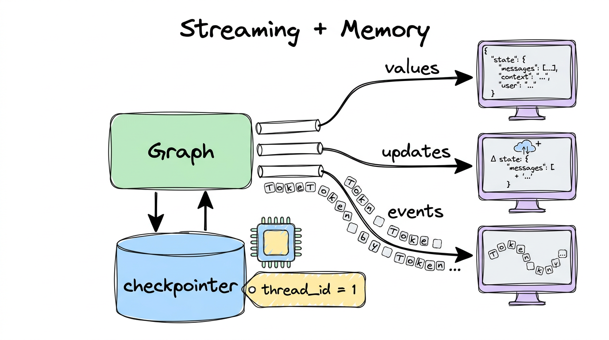
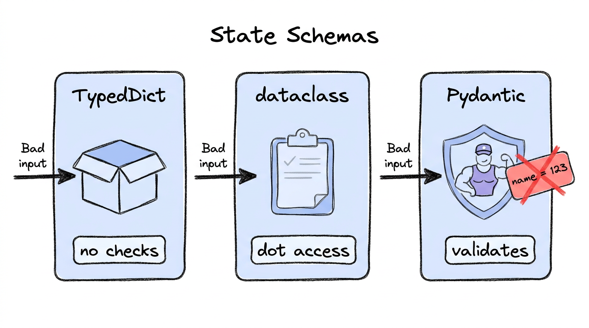
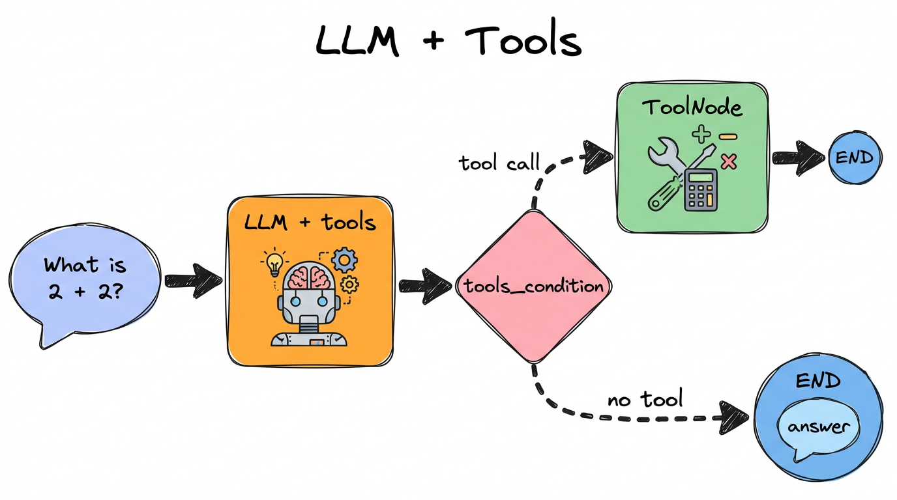
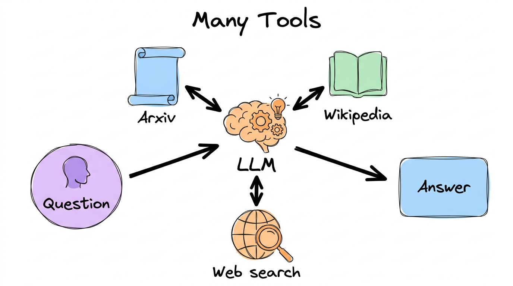

# 02. LangGraph components


## What is inside

| Notebook | What it shows |
|---|---|
| [1-streaming](../02-langgraph-components/1-streaming.ipynb) | Watch results as they happen, and give the graph memory |
| [3-DataclassStateSchema](../02-langgraph-components/3-DataclassStateSchema.ipynb) | Three ways to describe state (TypedDict, dataclass) |
| [4-pydantic](../02-langgraph-components/4-pydantic.ipynb) | State that checks its own data |
| [5-ChainsLangGraph](../02-langgraph-components/5-ChainsLangGraph.ipynb) | An AI model that can use a tool |
| [6-chatbotswithmultipletools](../02-langgraph-components/6-chatbotswithmultipletools.ipynb) | One model, several tools |
| [7-ReActAgents](../02-langgraph-components/7-ReActAgents.ipynb) | An agent that thinks, acts and repeats, with memory |

## 1. Streaming and memory



Instead of waiting for the whole answer, you can **stream** it.

- `stream_mode="values"`: the whole state after every step
- `stream_mode="updates"`: only what each step changed

**Memory** needs two things: a *checkpointer* (a place to save) and a *thread_id* (a name for the conversation).

```python
graph = builder.compile(checkpointer=MemorySaver())
config = {"configurable": {"thread_id": "1"}}
graph.invoke({"messages": "Hi, I like cricket"}, config)
graph.invoke({"messages": "What do I like?"}, config)   # it remembers: cricket
```

A new `thread_id` is a brand new conversation.

## 2. State schemas



| Style | Good for | Catch |
|---|---|---|
| `TypedDict` | Simple, fast | Does **not** check data. `{"name": 123}` is accepted |
| `dataclass` | Reading with `state.name` | Also no strict checking |
| `Pydantic` | Data from outside your code | Rejects bad data with an error |

## 3. Tools



A **tool** is a normal Python function the AI can ask you to run, like a calculator.

```python
def add(a: int, b: int) -> int:
    """Add a and b."""
    return a + b

llm_with_tools = llm.bind_tools([add])
```

Important: **the AI never runs the tool.** It only says "please call `add(2, 2)`". A `ToolNode` in your graph does the running, and `tools_condition` decides "tool needed, or finished?".

With several tools (Arxiv, Wikipedia, web search) the AI picks the right one:



## 4. The ReAct agent

An **agent** is a loop: **Think**, then **Act** (use a tool), then **Observe** the result, then repeat until done. One extra arrow from `tools` back to the model creates the loop.

```python
builder.add_edge("tools", "tool_calling_llm")   # the loop
```

The notebook also shows the shortcut that builds all this for you:

```python
agent = create_agent(model=llm, tools=tools, checkpointer=MemorySaver())
```

## What you should learn

- [ ] `stream` gives live results; `invoke` gives the final one
- [ ] Memory = checkpointer + `thread_id`
- [ ] When to pick TypedDict, dataclass or Pydantic
- [ ] `bind_tools`, `ToolNode` and `tools_condition` work together
- [ ] An agent is just a graph with a loop
- [ ] `create_agent` is the quick way to build one

## Try it yourself

Write a `subtract` tool, add it to the tool list, and ask the agent: "Add 5 and 8, then subtract 3."

**Previous:** [01](01-langgraph-basics.md) · **Next:** [03. Debugging](03-debugging.md)
