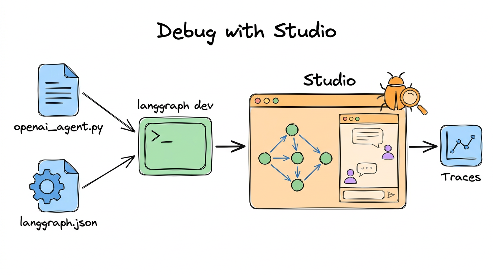

# 03. Debugging with LangGraph Studio



## What is inside

| File | What it is |
|---|---|
| [openai_agent.py](../03-debugging/openai_agent.py) | A small agent written as a normal Python file |
| [langgraph.json](../03-debugging/langgraph.json) | A config file that tells LangGraph where your agent is |

## The big idea, in simple words

Notebooks are great for learning. But when a graph misbehaves, you want to **see inside it**: which box ran, what the state looked like, what the model said.

**LangGraph Studio** is a web page that shows exactly that. It runs on your own computer and draws your graph, lets you chat with it, and shows every step.

Think of it as the **X-ray machine** for your agent.

## How it works

1. Your agent lives in a Python file and is exposed as a variable:

```python
agent = make_alternative_graph()      # in openai_agent.py
```

2. `langgraph.json` points to it:

```json
{
  "dependencies": ["."],
  "graphs": { "openai_agent": "./openai_agent.py:agent" },
  "env": "../.env"
}
```

3. In a terminal, from this folder, start the local server:

```bash
langgraph dev
```

4. Open the Studio link it prints, pick `openai_agent`, and chat with it.

## What the agent in the file does

`make_alternative_graph()` builds a small tool-calling agent with one tool, `add`. Ask "What is 2.5 + 4?" and you can watch the model call the tool, get 6.5, and answer.

## Tips

- Set `LANGSMITH_TRACING=true` and a `LANGSMITH_API_KEY` in your `.env` to also keep a full history of runs in LangSmith.
- The `"env": "../.env"` line loads your keys. **Never** commit the `.env` file.

## What you should learn

- [ ] How to expose a graph from a `.py` file
- [ ] What `langgraph.json` does
- [ ] How to start `langgraph dev` and open Studio
- [ ] How to read a run step by step to find a bug

## Official docs

- [Studio](https://docs.langchain.com/oss/python/langgraph/studio)
- [Run a local server](https://docs.langchain.com/oss/python/langgraph/local-server)

## Try it yourself

Start Studio, send "What is 10 + 5?", and open each step. Find the exact moment the tool is called.

**Previous:** [02](02-langgraph-components.md) · **Next:** [04. Workflows](04-workflows.md)
