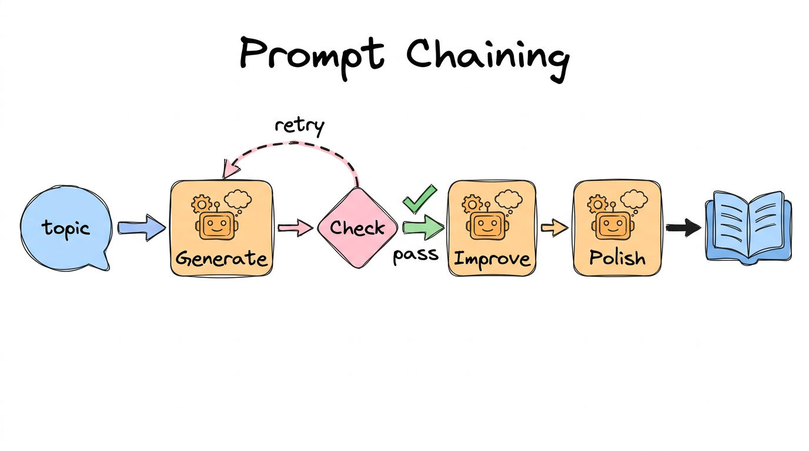
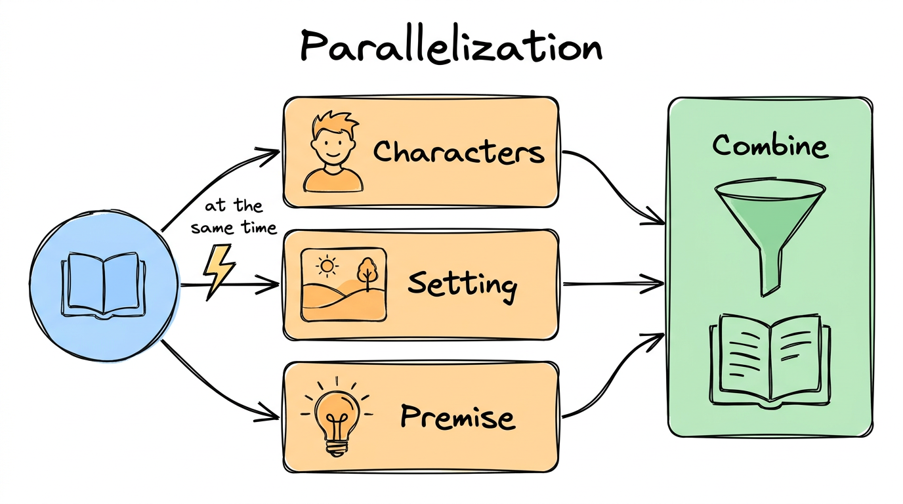
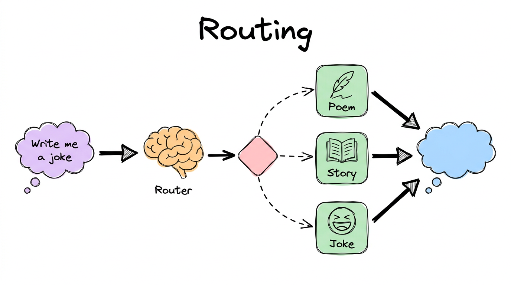
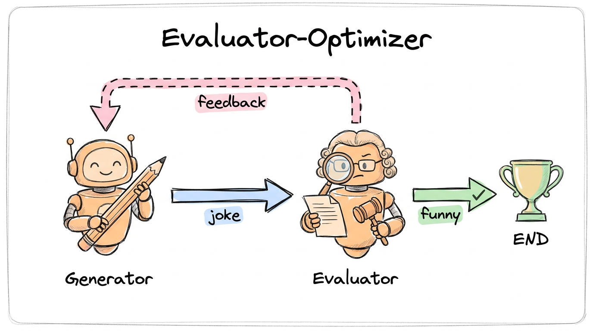

# 04. Workflows


## What is inside

| Notebook | Pattern |
|---|---|
| [1-prompting_chaining](../04-workflows/1-prompting_chaining.ipynb) | Do it in small steps, one after another |
| [2-parallelization](../04-workflows/2-parallelization.ipynb) | Do independent steps at the same time |
| [3-Routing](../04-workflows/3-Routing.ipynb) | Send the request to the right specialist |
| [4-orchestrator-worker](../04-workflows/4-orchestrator-worker.ipynb) | A boss plans, workers do the pieces |
| [5-Evaluator-optimizer](../04-workflows/5-Evaluator-optimizer.ipynb) | One writes, one judges, repeat until good |

## The big idea, in simple words

One big prompt often gives a messy answer. It works better to **split the job** and connect the pieces with a graph. These five patterns cover most real projects.

## 1. Prompt chaining



**Like an assembly line.** Write a story idea, then add details, then add a twist. A **gate** after step one can send it back if the idea is bad.

```python
builder.add_conditional_edges("generate", check_conflict,
                              {"Pass": "improve", "Fail": "generate"})
```

## 2. Parallelization



**Like three friends cooking different dishes.** Characters, setting and premise do not depend on each other, so they run **at the same time** and one box combines them. Faster than a chain.

```python
builder.add_edge(START, "character")
builder.add_edge(START, "setting")
builder.add_edge(START, "premise")
```

## 3. Routing



**Like a receptionist.** "Write me a joke" goes to the joke writer, a poem request goes to the poet. A model reads the request and returns a clean, typed choice.

```python
class Route(BaseModel):
    step: Literal["poem", "story", "joke"]

router = llm.with_structured_output(Route)
```

## 4. Orchestrator and workers

**Like a project manager.** You do not know in advance how many sections a report needs. The orchestrator makes a plan, then `Send` creates **one worker per section**. A final box joins them.

```python
def assign_workers(state):
    return [Send("llm_call", {"section": s}) for s in state["sections"]]
```

## 5. Evaluator and optimizer



**Like a writer and an editor.** The generator writes a joke, the evaluator says "funny" or "not funny" with feedback, and the loop continues until it is accepted.

## Which one to use?

| If your task is... | Use |
|---|---|
| A fixed list of steps | Chaining |
| Steps that do not depend on each other | Parallelization |
| Different kinds of requests | Routing |
| The number of pieces is unknown | Orchestrator-worker |
| Quality matters and you can judge it | Evaluator-optimizer |

## What you should learn

- [ ] Pick the right pattern for a task
- [ ] Fan out from `START` to run steps in parallel
- [ ] Use structured output to make clean decisions
- [ ] `Send` creates workers at run time
- [ ] A loop needs a way to stop (accept, or a retry limit)

## Try it yourself

In the evaluator notebook, change the topic and watch how many rounds it takes before the joke is accepted.

**Previous:** [03](03-debugging.md) · **Next:** [05. Human in the loop](05-human-in-the-loop.md)
