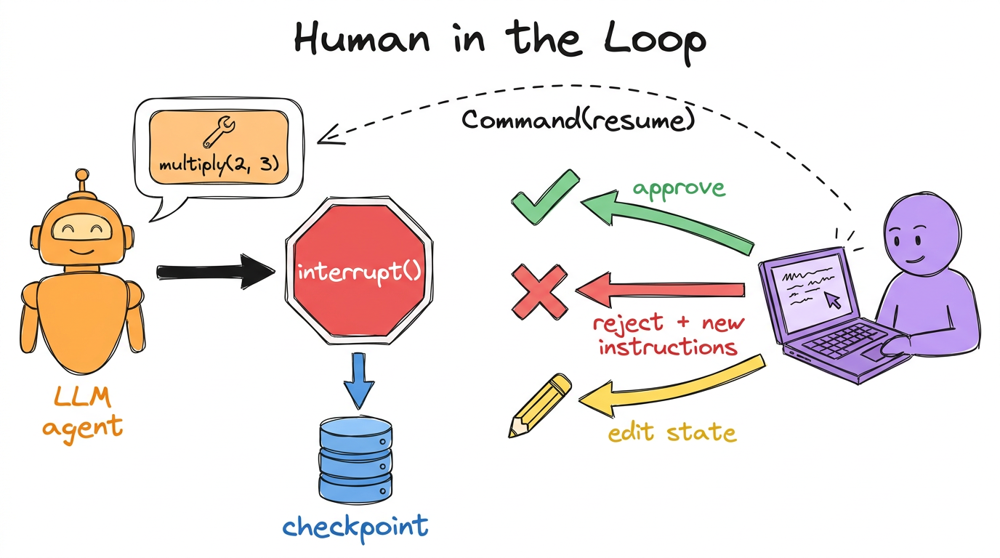
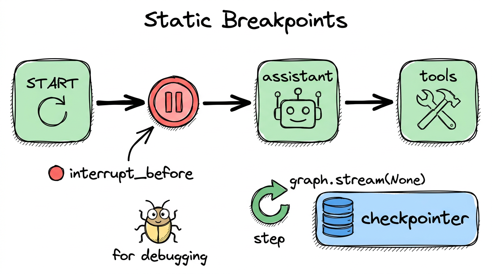

# 05. Human in the loop



## What is inside

| Notebook | What it shows |
|---|---|
| [1-Humanintheloop](../05-human-in-the-loop/1-Humanintheloop.ipynb) | Pause a graph, ask a person, then continue |

## The big idea, in simple words

AI agents can be wrong, or do things you do not want, like sending an email or spending money. So sometimes the graph should **stop and ask a human** before it goes on.

Think of a **bank clerk**. For a small transfer they just do it. For a big one they stop and say, "Manager, please approve this."

To pause and resume, LangGraph **saves the state** (a checkpoint) and continues later from the same place. That is why you need a checkpointer and a `thread_id`.

## Part 1: breakpoints (best for debugging)



`interrupt_before` pauses the graph **before a named box**. You then look around, and continue by streaming `None`.

```python
graph = builder.compile(interrupt_before=["assistant"], checkpointer=MemorySaver())
graph.stream(inputs, thread)     # runs until the pause
graph.stream(None, thread)       # continue
```

You can also look at the saved state (`get_state`) and **edit** it (`update_state`) before continuing.

## Part 2: `interrupt()` (best for real approvals)

The recommended way is to pause **from inside a box**.

```python
def human_approval(state):
    decision = interrupt({"question": "Approve this tool call?"})   # graph pauses here
    if decision == "approve":
        return Command(goto="tools")
    return Command(goto="assistant", update={"messages": [HumanMessage(decision)]})
```

Then the person answers, and you resume:

```python
graph.invoke(Command(resume="approve"), thread)
```

Whatever you pass to `resume=` becomes the return value of `interrupt()`.

## Example from the notebook

1. You ask: "Multiply 2 and 3."
2. The agent proposes the tool call `multiply(2, 3)`, then **pauses**.
3. You can reply `approve`, **or** type "No, multiply 15 and 6", and the agent starts again with the new instruction.

## Rules to remember

- Always resume with the **same `thread_id`**.
- When resumed, the box **starts again from its first line**, so code before `interrupt()` should be safe to repeat.
- Do not hide `interrupt()` inside a bare `try/except`.

## What you should learn

- [ ] Why checkpoints make pausing possible
- [ ] `interrupt_before` for debugging, `interrupt()` for approvals
- [ ] How `Command(resume=...)` sends the answer back
- [ ] How `Command(goto=..., update=...)` chooses the next step and changes state
- [ ] Approve, reject and edit are three common human decisions

## Official docs

- [Interrupts](https://docs.langchain.com/oss/python/langgraph/interrupts)
- [Persistence](https://docs.langchain.com/oss/python/langgraph/persistence)

## Try it yourself

Make the approval step only ask a human for `divide` calls, and let `add` and `multiply` run automatically.

**Previous:** [04](04-workflows.md) · **Next:** [06. RAG](06-rag.md)
