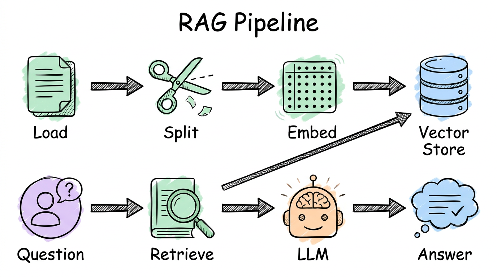
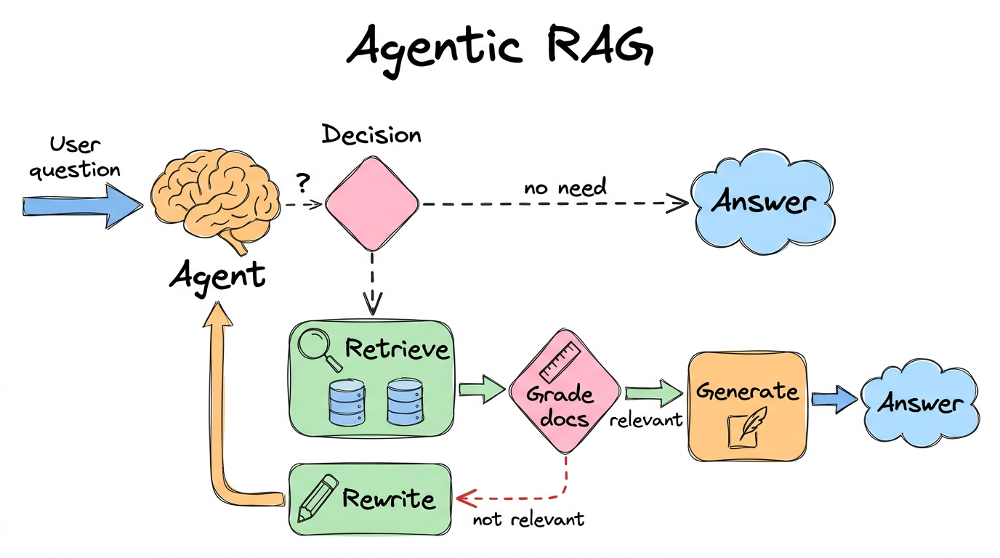
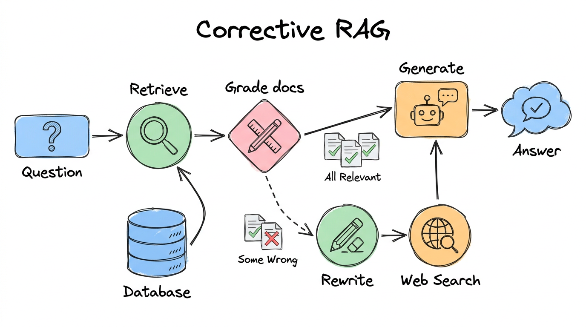

# 06. RAG (Retrieval-Augmented Generation)



## What is inside

| Notebook | What it shows |
|---|---|
| [1-AgenticRAG](../06-rag/1-AgenticRAG.ipynb) | The AI decides when to look things up |
| [2-CorrectiveRAG](../06-rag/2-CorrectiveRAG.ipynb) | Bad results are fixed with a web search |
| [4-AdaptiveRAG](../06-rag/4-AdaptiveRAG.ipynb) | Routes the question and double-checks the answer |

## The big idea, in simple words

An AI model only knows what it learned in training. It does not know **your** documents. RAG fixes that:

1. **Load** your documents (here, web pages).
2. **Split** them into small pieces.
3. **Embed** each piece (turn it into numbers that capture its meaning).
4. **Store** the numbers in a vector store.
5. When someone asks a question, **retrieve** the closest pieces and give them to the AI to answer.

Think of an **open-book exam**. The AI does not memorize the book. It looks up the right page, then answers.

## Agentic RAG



The AI **decides** if it needs the documents at all.

- "What is LangGraph?" → it looks it up.
- "What is machine learning?" → it answers directly.

After looking up, a **grader** asks: "are these pages relevant?" If not, the question is **rewritten** and tried again.

```python
retriever_tool = create_retriever_tool(retriever, "search_docs", "Search LangGraph docs")
```

## Corrective RAG



Every retrieved page is graded. If some are wrong, the graph **rewrites the question and searches the web**, then answers using the good pages plus the web result.

Example from the notebook: "Who won the most recent FIFA World Cup?" is not in the blog posts, so the web search fills the gap.

## Adaptive RAG


The smartest of the three:

1. A **router** picks: vector store, or web search.
2. After the answer, a **hallucination grader** asks "is this really backed by the documents?"
3. An **answer grader** asks "does this actually answer the question?"
4. If not, it tries again.

## Notes on this code

- It uses `InMemoryVectorStore`, so there is nothing extra to install or run.
- Web search uses OpenAI's built-in search tool, so no extra API key is needed.

## What you should learn

- [ ] The five steps: load, split, embed, store, retrieve
- [ ] Why graders make answers more trustworthy
- [ ] How each RAG type adds one new idea: *decide*, then *correct*, then *route and verify*
- [ ] How to turn a retriever into a tool

## Official docs

- [RAG](https://docs.langchain.com/oss/python/langchain/rag)
- [Retrieval](https://docs.langchain.com/oss/python/langchain/retrieval)
- [Agentic RAG](https://docs.langchain.com/oss/python/langgraph/agentic-rag)

## Try it yourself

In Corrective RAG, ask a question about agent memory (answer is in the posts) and then one about today's news (answer needs the web). Watch which path the printed `---STEP---` lines follow.

**Previous:** [05](05-human-in-the-loop.md) · **Next:** [07. Multimodal](07-multimodal.md)
